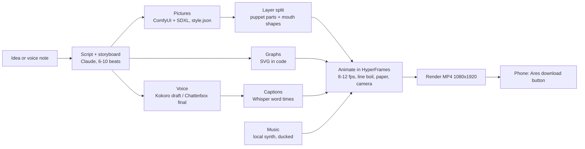

# Sketchbook Reels: architecture (plan, nothing built yet; 2026-10-10)

## Parts and where they live
| Part | Tool | Location | Status |
|---|---|---|---|
| Pictures | ComfyUI + SDXL base | `C:\dev\comfy` | downloading |
| Animation + render | HyperFrames, FFmpeg 9.0.2 | `C:\dev\reel-edits`, `C:\dev\tools` | working (story video) |
| Captions | faster-whisper large-v3(-turbo) | HF cache | working |
| Voice | Kokoro (working), Chatterbox (to test) | `C:\dev\Virtual Assistant` / tbd | partial |
| Music | numpy synth + sidechain ducking | `make_music.py` | working |
| Delivery | Ares phone page 🎬 | `C:\dev\Virtual Assistant` | working |
## Contracts
- Storyboard = JSON list of beats: `{voice, picture_prompt | graph, seconds}`.
- Each beat renders to its own cached clip; the final joins them (resume after a crash).
- Style = one `style.json` (prompt, seed, LoRA, negative prompt) reused for every picture.
## Limits (6 GB GPU)
Stills yes; characters move by puppet parts, not by video models; clips from video models are short and slow.
